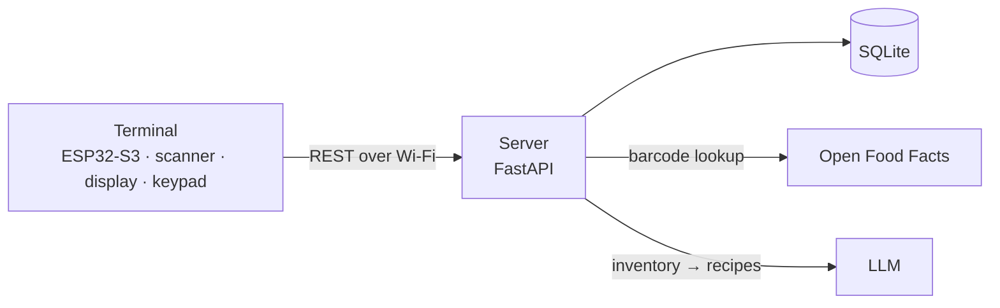

# Smart Grocery Tracker

IoT pantry tracker: an ESP32-based terminal with a barcode scanner, display and keypad, connected to a central server that keeps track of what's at home and suggests meals using AI.

>Work in progress — early design stage.

## Motivation

"What can I cook with what I have?" is hard to answer when you don't remember what's in the cupboards. This project keeps a live inventory of groceries at home and feeds it to an AI model to get meal suggestions based on what's actually available, prioritizing products that are opened or close to expiry.

## How it works

1. **Unpacking groceries** — scan each product's barcode in *IN* mode. The server looks it up in its database or in [Open Food Facts](https://world.openfoodfacts.org/) and adds the package to the inventory.
2. **Throwing something out** — scan it in *OUT* mode and it's removed from the inventory.
3. **Products without barcodes** (vegetables, eggs…) — pick them from a quick-items menu on the terminal.
4. **"What should I cook?"** — the server sends the current inventory to an LLM and returns recipe suggestions.

## Architecture

The terminal is intentionally thin: it only reports scans and displays responses. All logic (product lookup, inventory, recipes) lives on the server.

## Repository structure

| Directory | Contents |
|---|---|
| `firmware/` | ESP-IDF project for the terminal |
| `server/` | Backend: REST API, database, AI integration |
| `hardware/` | Schematics, PCB, 3D-printed enclosure |
| `docs/` | Architecture notes, API specification |

## Hardware (planned)

- ESP32-S3
- UART barcode scanner module (1D + QR)
- 2.4–2.8" SPI TFT display (ILI9341)
- 4×4 matrix keypad

## Roadmap

- [ ] Server: product catalog + Open Food Facts lookup
- [ ] Server: inventory (one entry per package) + scan endpoint
- [ ] Terminal: barcode scanner → scan API
- [ ] Terminal: display + keypad UI (IN/OUT mode, quick items)
- [ ] AI recipe suggestions
- [ ] Offline scan queue with sync
- [ ] Expiry dates, weight-based quantities
- [ ] 3D-printed enclosure

## License

[MIT](LICENSE)